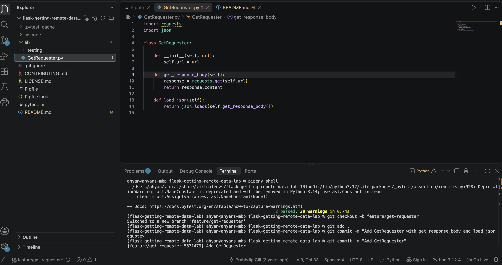

# Retrieving Remote Data from an API

A small Python class for pulling JSON from a remote endpoint. It was built for a company directory dashboard, where a Flask app needs the latest employee records on each page load.

## How it works

`GetRequester` takes a URL when you create it.

- `get_response_body()` sends an HTTP GET request to the URL and returns the raw response body.
- `load_json()` calls `get_response_body()` and parses the result into Python lists and dicts.

## Setup

```
pipenv install
pipenv shell
```

## Usage

```python
from lib.GetRequester import GetRequester

requester = GetRequester("https://learn-co-curriculum.github.io/json-site-example/endpoints/people.json")
people = requester.load_json()
print(people)
```

## Tests

```
pytest
```

## Screenshot


